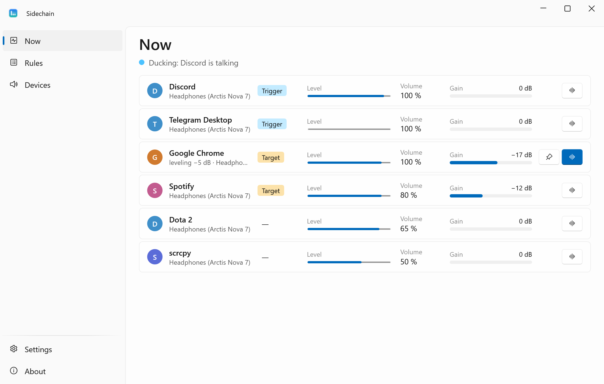
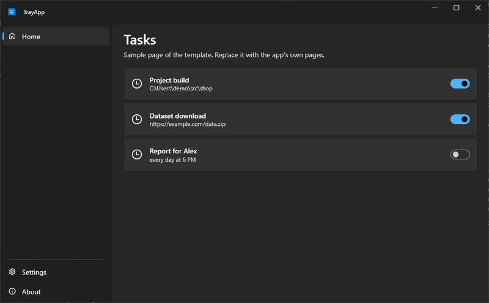
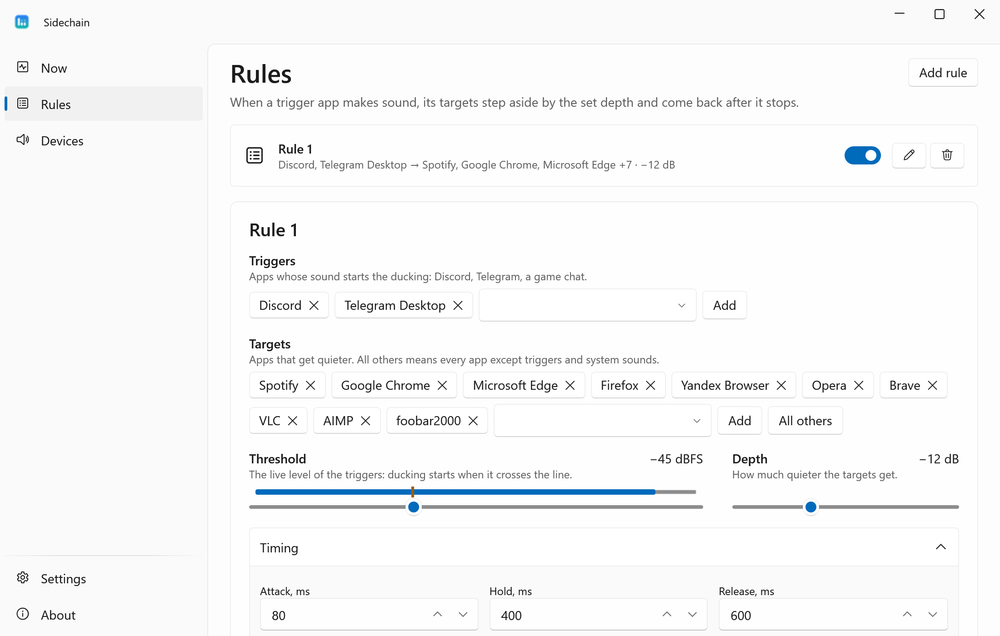
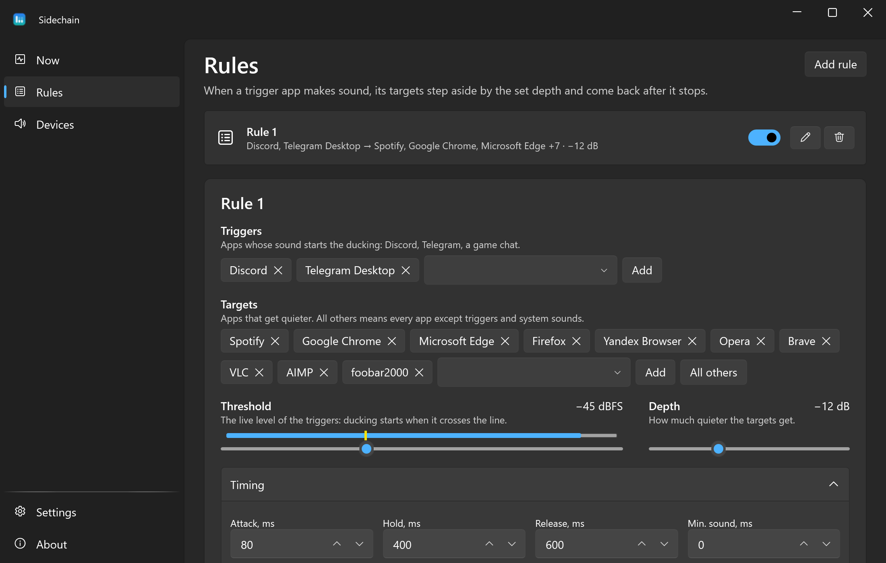
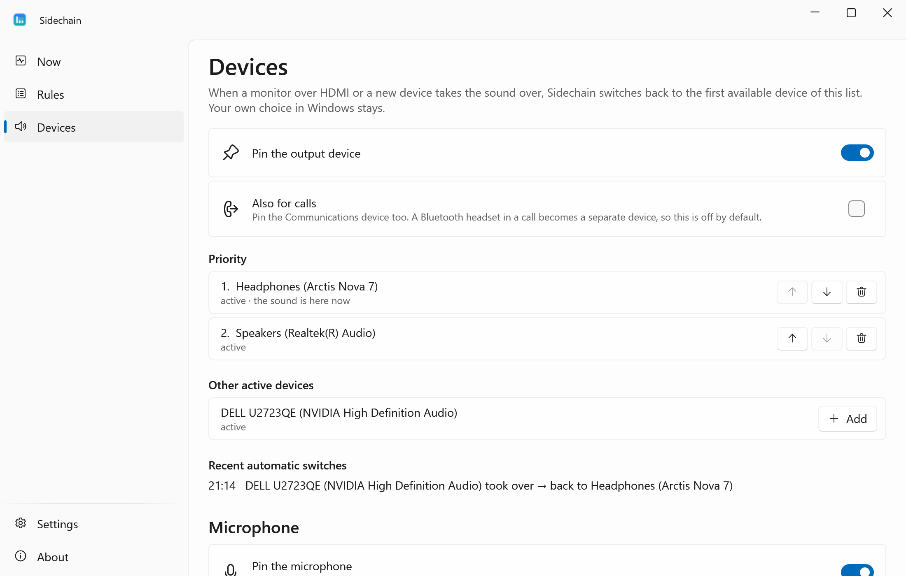
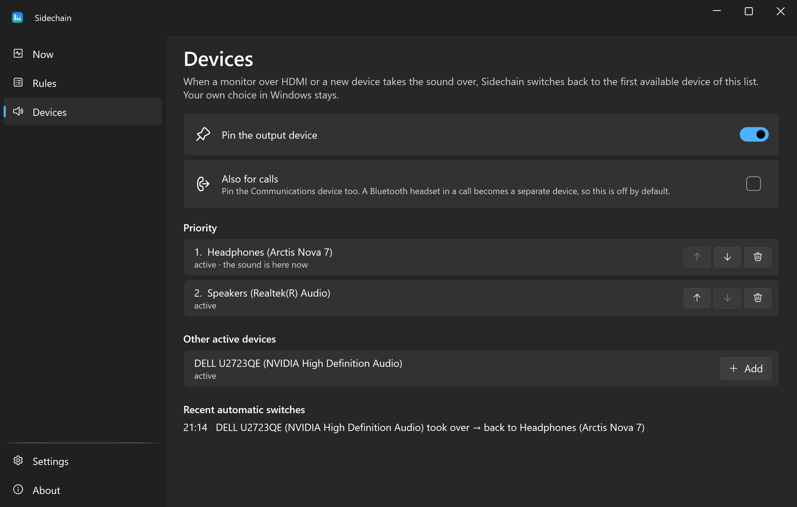
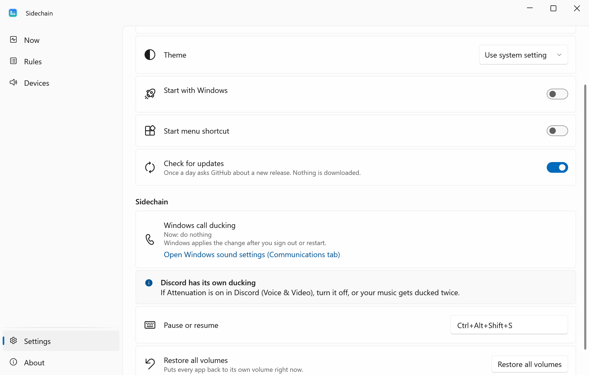
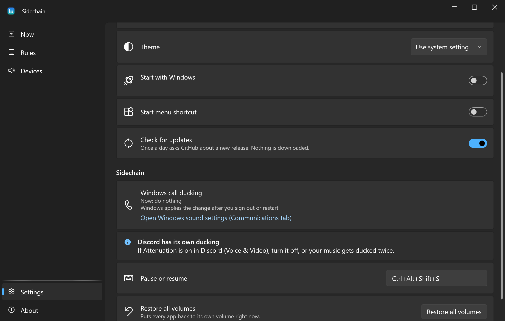

<div align="center">


# Sidechain

**Someone talks in Discord, your music and browser step aside, then come back.**

**English** · [Русский](README.ru.md)

[](https://github.com/lojekq/Sidechain/releases/latest)
[](https://github.com/lojekq/Sidechain/releases)
[](https://github.com/lojekq/Sidechain/actions/workflows/ci.yml)

[](LICENSE)

<picture>
  <source media="(prefers-color-scheme: dark)" srcset="docs/live-dark-en.png">
  
</picture>
</div>

## Why

Per-app sidechain for Windows: when someone talks in Discord, your music and browser step aside — and come back when they stop.
No more pausing Spotify for every call or missing a word under a loud video.
Sidechain only changes the volume of other apps, so the sound itself never passes through it.

## Features

- **Ducks by real sound levels** — threshold, depth in dB, attack, hold and release; any app can be a trigger or a target, or "all others".
- **Whole apps, your volume first** — a browser or a multi-process app counts as one app; ducking is relative to your own volume, and your moves in the mixer win.
- **Leveler** — a browser with a loud ad gets turned down slowly and only down; "make this level the norm" in one click.
- **Safe** — volumes come back on exit, sleep, a crash or the next start; one button restores everything.
- **Device pinning** — an HDMI monitor, a webcam or a new headset can't steal the output or the microphone; your own choice in Windows is never undone.
- **Fixes the Windows call ducking clash** — one click turns off the built-in "reduce other sounds during calls".
- **Light** — tray app, no admin rights, no telemetry, no virtual audio device and no latency; about 0 % CPU.

## See it in action



## How it works

Sidechain uses Windows Core Audio sessions. 40 times a second it reads the peak meters of the trigger apps,
keeps a gate with a hold, and moves the session volume of the targets in decibels from your own volume.
Windows remembers every app's volume forever, so a restore journal keeps your levels until they are back.
The leveler measures the loudness (RMS) of a chosen app through Windows process loopback and turns it down 6 dB/s, up 1 dB/s, 12 dB at most.
It is a slow automatic volume, not a limiter: the first half second of a loud ad is still loud.

## Screenshots

| | Light | Dark |
|---|---|---|
| Rules |  |  |
| Devices |  |  |
| Settings |  |  |

## Download

1. Get **`Sidechain-x.y.z-win-x64.exe`** from [Releases](https://github.com/lojekq/Sidechain/releases/latest). Single file, no install, no admin.
2. Smaller build: `Sidechain-x.y.z-win-x64-fd.zip` (needs [.NET Desktop Runtime 10](https://dotnet.microsoft.com/download/dotnet/10.0)).
3. Optional check: `gh attestation verify <file> -R lojekq/Sidechain` or compare with `SHA256SUMS.txt`.

Requirements: Windows 11 x64. Windows 10 22H2 should work but is not tested.

## First run

Put the exe into a permanent folder first, for example `%LOCALAPPDATA%\Programs\Sidechain\`: autostart and the shortcut point to it.
On the first start Windows may show a SmartScreen warning (see FAQ). The app then lives in the tray; turn on **Start with Windows** in Settings.
The first rule is ready: Discord and Telegram duck Spotify, browsers and players by 12 dB. Games are not ducked unless you add them.

## Settings

| Setting | Default | What it does |
|---|---|---|
| Rules | Discord, Telegram → Spotify, Chrome, Edge, Firefox, Yandex Browser, Opera, Brave, VLC, AIMP, foobar2000 | When a trigger is louder than the threshold (−45 dBFS), the targets go down by the depth (12 dB) |
| Timing | attack 80 ms, hold 400 ms, release 600 ms | How fast the targets go down, how long pauses between words are bridged, how fast they come back |
| Min. sound | 0 ms | Shorter sounds of a trigger (a Discord notification) don't duck |
| Leveler | off | The equalizer button on a row of the Now page; norm −20 dBFS until you press the pin button next to it; 3 apps at most |
| Pin the output device | on, with the device that was default at the first start | Switches back when a device that just appeared (HDMI monitor, new headset) takes the default |
| Also for calls | off | Pins the Communications device too |
| Pin the microphone | on, with the microphone that was default at the first start | The same for the microphone: a webcam won't become the default one |
| Pause or resume | `Ctrl+Alt+Shift+S` | A global hotkey; clear it in Settings |
| Windows call ducking | not touched | **Turn off** sets Windows to "Do nothing" during calls; **Restore as it was** brings your value back |
| Language, theme | Windows | English or Russian (after a restart), light or dark |
| Start with Windows | off | Starts minimized to the tray |
| Start menu shortcut | on when the exe is in `%LOCALAPPDATA%\Programs\Sidechain\` | A shortcut in the Start menu |
| Check for updates | on | Once a day asks GitHub about a new release |

Settings, the restore journal and logs live in `%APPDATA%\Sidechain`. The tray menu also has Pause (15 min, 1 h, until resumed), the output device and **Restore all volumes**.

## FAQ

<details><summary>Windows protected your PC / SmartScreen warning</summary>

The exe is not code-signed yet, so Windows does not know the publisher. Click **More info → Run anyway**.
Every file is built by GitHub Actions from this repository; you can check it with `gh attestation verify` or `SHA256SUMS.txt`.
Smart App Control, if it is on, blocks unsigned files with no way to allow one; the only option is to turn it off.
</details>

<details><summary>My antivirus flags it</summary>

It is a false positive: the app has no installer, no packer and no obfuscation. The leveler's process loopback may look like audio capture to a heuristic; see Privacy. Please report it to your antivirus vendor
and open an issue with the detection name and the SHA256 of the file.
</details>

<details><summary>Spotify stayed quiet after Sidechain was killed</summary>

Start Sidechain again: it reads the restore journal and gives the volume back. Or set the volume in the Windows mixer yourself.
On a normal exit, sleep or sign-out the volumes come back at once.
</details>

<details><summary>Music is ducked twice during calls</summary>

Windows and Discord can duck too. Turn off the Windows one in Settings (Windows applies it after a sign-out or a restart),
and turn off **Attenuation** in Discord → Voice & Video.
</details>

<details><summary>Can it duck one browser tab, or a game's voice chat apart from the game?</summary>

No. All tabs of Chrome or Edge are one audio session in Windows, and a game plays its chat and its sound from one process.
Apps that use WASAPI exclusive mode can't be ducked at all.
</details>

<details><summary>How do I uninstall?</summary>

About → **Remove data and autostart**, then delete the exe. Volumes are restored before the data is removed.
</details>

## Privacy

No telemetry. The only network request is the update check: `GET https://api.github.com/repos/lojekq/Sidechain/releases/latest` once a day; turn it off in Settings.
Ducking reads only the level meters Windows provides and sets session volumes.
The leveler listens to the apps you choose through Windows process loopback; the samples stay in memory for the loudness sum and are never recorded, saved or sent.
Logs contain no window titles, paths or device names.

## Build from source

```powershell
winget install Microsoft.DotNet.SDK.10
git clone https://github.com/lojekq/Sidechain
cd Sidechain
dotnet run --project src/Sidechain
dotnet test
```

`--demo` runs the app on made-up apps and devices without touching real audio.

## License

MIT © 2026 lojekq
