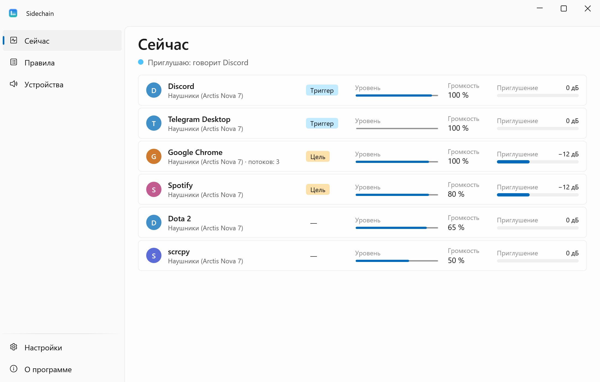
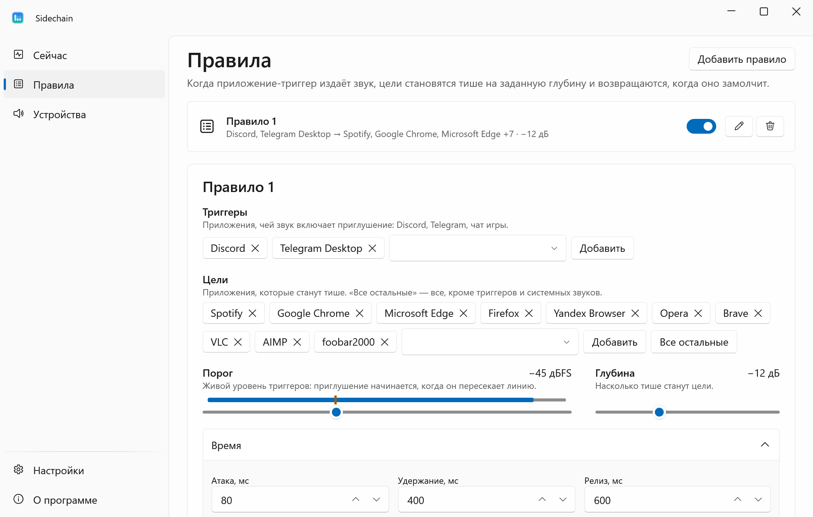
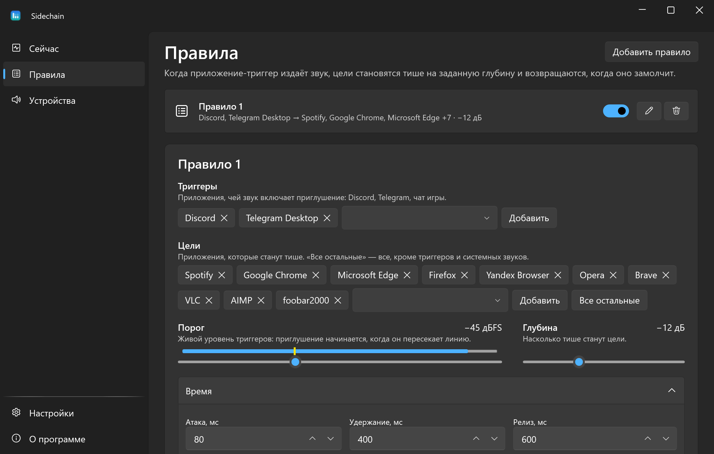
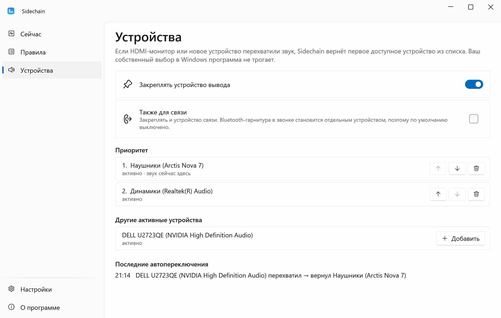
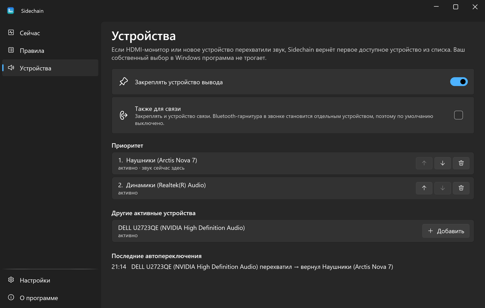

<div align="center">


# Sidechain

**Заговорили в Discord — музыка и браузер стали тише, замолчали — громкость вернулась.**

[English](README.md) · **Русский**

[](https://github.com/lojekq/Sidechain/releases/latest)
[](https://github.com/lojekq/Sidechain/releases)
[](https://github.com/lojekq/Sidechain/actions/workflows/ci.yml)

[](LICENSE)

<picture>
  <source media="(prefers-color-scheme: dark)" srcset="docs/live-dark-ru.png">
  
</picture>
</div>

## Зачем

Сайдчейн для приложений Windows: заговорили в Discord — музыка и браузер стали тише, замолчали — громкость вернулась.
Не нужно ставить Spotify на паузу перед каждым звонком и переспрашивать собеседника из-за громкого видео.
Sidechain меняет только громкость других приложений, сам звук через программу не проходит.

## Возможности

- **Приглушение по реальному уровню звука** — порог, глубина в дБ, атака, удержание и релиз; любое приложение может быть триггером или целью, есть режим «все остальные».
- **Приложение целиком, ваша громкость главнее** — браузер и многопроцессные приложения считаются одним приложением; громкость считается от вашей, а ваши изменения в микшере имеют приоритет.
- **Безопасно** — громкости возвращаются при выходе, сне, падении или при следующем запуске; одна кнопка возвращает всё.
- **Закрепление устройства вывода** — HDMI-монитор или новое устройство не уводят звук, а ваш собственный выбор в Windows программа не трогает.
- **Конфликт с приглушением Windows при звонках** — встроенное «уменьшать громкость других звуков» отключается одной кнопкой.
- **Легко** — трей, без прав администратора, без телеметрии, без виртуальных аудиоустройств и задержки; около 0 % CPU.

## Как это выглядит


## Как это работает

Sidechain работает с сессиями Windows Core Audio. 40 раз в секунду он читает пиковые индикаторы приложений-триггеров,
держит гейт с удержанием и плавно меняет громкость сессий целей в децибелах относительно вашей громкости.
Windows навсегда запоминает громкость каждого приложения, поэтому журнал восстановления хранит ваши уровни, пока они не вернутся.

## Скриншоты

| | Светлая | Тёмная |
|---|---|---|
| Правила |  |  |
| Устройства |  |  |
| Настройки |  |  |

## Скачать

1. Скачайте **`Sidechain-x.y.z-win-x64.exe`** из [Releases](https://github.com/lojekq/Sidechain/releases/latest). Один файл, без установки и прав администратора.
2. Сборка поменьше: `Sidechain-x.y.z-win-x64-fd.zip` (нужен [.NET Desktop Runtime 10](https://dotnet.microsoft.com/download/dotnet/10.0)).
3. Проверка по желанию: `gh attestation verify <файл> -R lojekq/Sidechain` или сверка с `SHA256SUMS.txt`.

Требования: Windows 11 x64. Windows 10 22H2 должна работать, но не тестируется.

## Первый запуск

Сначала положите exe в постоянную папку, например `%LOCALAPPDATA%\Programs\Sidechain\`: автозапуск и ярлык указывают на него.
При первом запуске Windows может показать предупреждение SmartScreen (см. «Вопросы»). Дальше программа живёт в трее; в настройках включите **«Запускать вместе с Windows»**.
Первое правило уже готово: Discord и Telegram приглушают Spotify, браузеры и плееры на 12 дБ. Игры не приглушаются, пока вы их не добавите.

## Настройки

| Настройка | По умолчанию | Что делает |
|---|---|---|
| Правила | Discord, Telegram → Spotify, Chrome, Edge, Firefox, Яндекс Браузер, Opera, Brave, VLC, AIMP, foobar2000 | Когда триггер громче порога (−45 дБFS), цели становятся тише на глубину (12 дБ) |
| Время | атака 80 мс, удержание 400 мс, релиз 600 мс | Как быстро цели становятся тише, какие паузы между словами не отпускают приглушение, как быстро громкость возвращается |
| Закреплять устройство вывода | вкл., с устройством, которое было по умолчанию при первом запуске | Возвращает его, если «по умолчанию» перехватило только что появившееся устройство (HDMI-монитор, новая гарнитура) |
| Также для связи | выкл. | Закрепляет и устройство связи |
| Приглушение при звонках в Windows | не трогается | **«Отключить»** ставит в Windows «Ничего не делать»; **«Вернуть как было»** возвращает ваше значение |
| Язык, тема | как в Windows | русский или английский (после перезапуска), светлая или тёмная |
| Запускать вместе с Windows | выкл. | стартует свёрнутой в трей |
| Ярлык в меню «Пуск» | вкл., если exe лежит в `%LOCALAPPDATA%\Programs\Sidechain\` | ярлык в «Пуске» |
| Проверять обновления | вкл. | раз в день спрашивает у GitHub о новом релизе |

Настройки, журнал восстановления и логи лежат в `%APPDATA%\Sidechain`. В меню трея ещё есть «Пауза» (15 мин, 1 ч, до включения), выбор устройства вывода и **«Вернуть все громкости»**.

## Вопросы

<details><summary>«Система Windows защитила ваш компьютер» / предупреждение SmartScreen</summary>

Exe пока без цифровой подписи, поэтому Windows не знает издателя. Нажмите **«Подробнее» → «Выполнить в любом случае»**.
Каждый файл собирает GitHub Actions из этого репозитория; проверить его можно через `gh attestation verify` или `SHA256SUMS.txt`.
Если включён Smart App Control, он блокирует неподписанные файлы без возможности разрешить один; остаётся только выключить его.
</details>

<details><summary>Антивирус ругается на программу</summary>

Это ложное срабатывание: у программы нет установщика, упаковщика и обфускации. Сообщите об этом производителю антивируса
и откройте issue с именем детекта и SHA256 файла.
</details>

<details><summary>Spotify остался тихим после того, как Sidechain завершили через диспетчер задач</summary>

Запустите Sidechain снова: он прочитает журнал восстановления и вернёт громкость. Или поставьте громкость в микшере Windows сами.
При обычном выходе, сне и выходе из системы громкости возвращаются сразу.
</details>

<details><summary>Во время звонка музыка приглушается дважды</summary>

Приглушать умеют ещё Windows и Discord. Приглушение Windows отключается в настройках (Windows применит это после выхода из системы или перезагрузки),
в Discord выключите **«Приглушение»** в разделе «Голос и видео».
</details>

<details><summary>Можно приглушить одну вкладку браузера или голосовой чат игры отдельно от игры?</summary>

Нет. Все вкладки Chrome или Edge — одна аудиосессия Windows, а игра выводит чат и звук одним процессом.
Приложения в эксклюзивном режиме WASAPI приглушить нельзя совсем.
</details>

<details><summary>Как удалить?</summary>

«О программе» → **«Удалить данные и автозапуск»**, затем удалите exe. Громкости возвращаются до удаления данных.
</details>

## Приватность

Телеметрии нет. Единственный сетевой запрос — проверка обновлений: `GET https://api.github.com/repos/lojekq/Sidechain/releases/latest` раз в день; выключается в настройках.
Sidechain не записывает и не захватывает звук: он читает индикаторы уровня, которые даёт Windows, и меняет громкость сессий.
В логах нет заголовков окон, путей и названий устройств.

## Сборка из исходников

```powershell
winget install Microsoft.DotNet.SDK.10
git clone https://github.com/lojekq/Sidechain
cd Sidechain
dotnet run --project src/Sidechain
dotnet test
```

`--demo` запускает программу на выдуманных приложениях и устройствах, не трогая настоящий звук.

## Лицензия

MIT © 2026 lojekq
