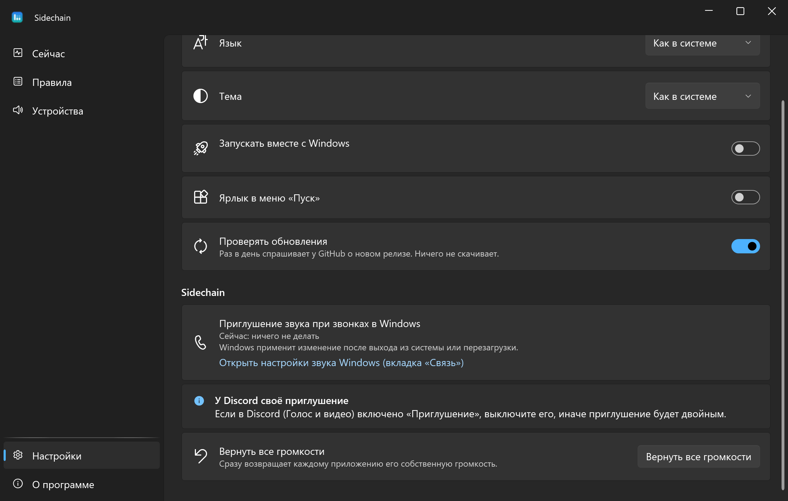
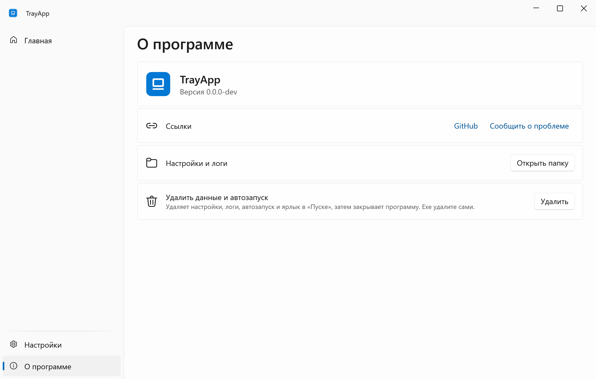

<div align="center">


# Sidechain

**Каркас небольших программ в трее Windows: один exe, RU/EN, светлая и тёмная тема, релизы из CI.**

[English](README.md) · **Русский**

[](https://github.com/lojekq/Sidechain/releases/latest)
[](https://github.com/lojekq/Sidechain/releases)
[](https://github.com/lojekq/Sidechain/actions/workflows/ci.yml)

[](LICENSE)

<picture>
  <source media="(prefers-color-scheme: dark)" srcset="docs/main-dark-ru.png">
  
</picture>
</div>


## Зачем

Каждой маленькой утилите для Windows нужны одни и те же скучные части: значок в трее, настройки, автозапуск, два языка, лог падений и релиз с контрольными суммами.
В Sidechain они сделаны один раз, и программа добавляет только свои страницы.

## Возможности

- **Живёт в трее** — левый клик открывает окно, крестик прячет его, «Выход» в меню трея.
- **Один exe** — без установщика и прав администратора; ярлык в «Пуске» и автозапуск включаются в настройках.
- **Русский и английский, светлая и тёмная тема** — как в Windows или по вашему выбору.
- **Честные обновления** — раз в день спрашивает у GitHub о новом релизе, показывает заметку и ничего не скачивает.
- **Лог падений** — при ошибке программа останавливается и показывает, где лог; ничего никуда не отправляется.

## Как это выглядит


## Скриншоты

| | Светлая | Тёмная |
|---|---|---|
| Настройки |  |  |
| О программе |  |  |

## Скачать

1. Скачайте **`Sidechain-x.y.z-win-x64.exe`** из [Releases](https://github.com/lojekq/Sidechain/releases/latest). Один файл, без установки и прав администратора.
2. Сборка поменьше: `Sidechain-x.y.z-win-x64-fd.zip` (нужен [.NET Desktop Runtime 10](https://dotnet.microsoft.com/download/dotnet/10.0)).
3. Проверка по желанию: `gh attestation verify <файл> -R lojekq/Sidechain` или сверка с `SHA256SUMS.txt`.

Требования: Windows 11 x64. Windows 10 22H2 должна работать, но не тестируется.

## Первый запуск

Сначала положите exe в постоянную папку, например `%LOCALAPPDATA%\Programs\Sidechain\`: автозапуск и ярлык указывают на него.
При первом запуске Windows может показать предупреждение SmartScreen (см. «Вопросы»). Дальше программа живёт в трее; в настройках включите **«Запускать вместе с Windows»**.

## Настройки

| Настройка | По умолчанию | Что делает |
|---|---|---|
| Язык | язык Windows | русский или английский, после перезапуска |
| Тема | тема Windows | светлая или тёмная |
| Запускать вместе с Windows | выкл. | стартует свёрнутой в трей |
| Ярлык в меню «Пуск» | вкл., если exe лежит в `%LOCALAPPDATA%\Programs\Sidechain\` | ярлык в «Пуске» |
| Проверять обновления | вкл. | раз в день спрашивает у GitHub о новом релизе |

Настройки и логи лежат в `%APPDATA%\Sidechain`.

## Вопросы

<details><summary>«Система Windows защитила ваш компьютер» / предупреждение SmartScreen</summary>

Exe пока без цифровой подписи, поэтому Windows не знает издателя. Нажмите **«Подробнее» → «Выполнить в любом случае»**.
Каждый файл собирает GitHub Actions из этого репозитория; проверить его можно через `gh attestation verify` или `SHA256SUMS.txt`.
Если включён Smart App Control, он блокирует неподписанные файлы без возможности разрешить один; остаётся только выключить его.
</details>

<details><summary>Антивирус ругается на программу</summary>

Это ложное срабатывание: у программы нет установщика, упаковщика и обфускации. Сообщите об этом производителю антивируса
и откройте issue с именем детекта и SHA256 файла.
</details>

<details><summary>Как удалить?</summary>

«О программе» → **«Удалить данные и автозапуск»**, затем удалите exe.
</details>

## Приватность

Телеметрии нет. Единственный сетевой запрос — проверка обновлений: `GET https://api.github.com/repos/lojekq/Sidechain/releases/latest` раз в день; выключается в настройках.
В логах нет заголовков окон, путей и других личных данных.

## Сборка из исходников

```powershell
winget install Microsoft.DotNet.SDK.10
git clone https://github.com/lojekq/Sidechain
cd Sidechain
dotnet run --project src/Sidechain
dotnet test
```

## Лицензия

MIT © 2026 lojekq
